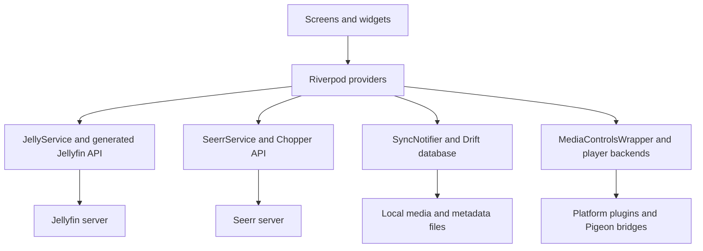
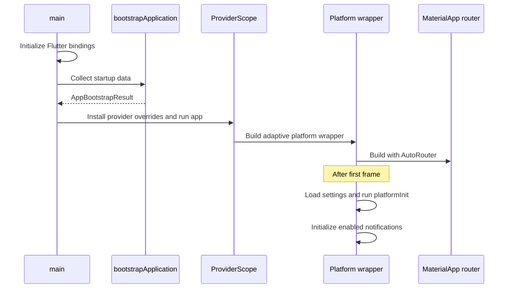
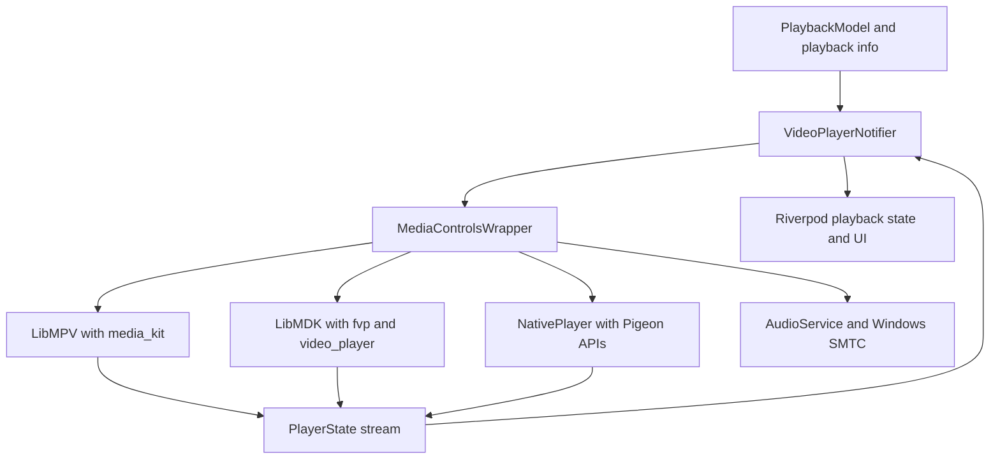
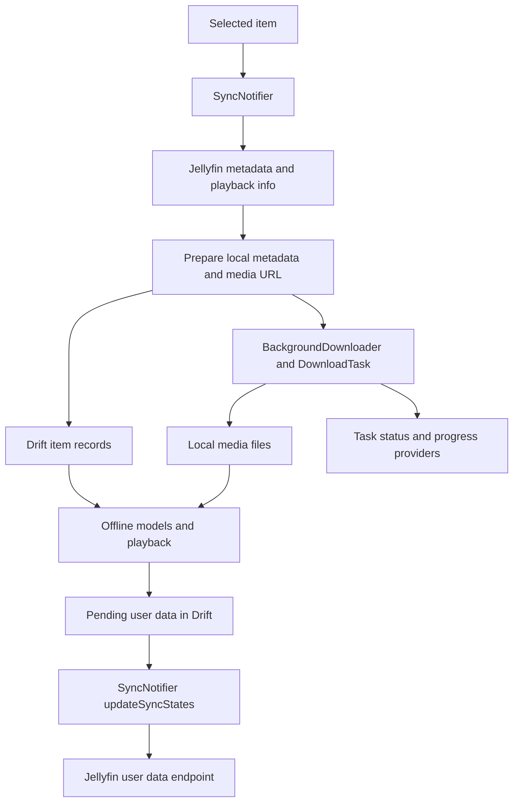

# Architecture

## Component overview

Fladder is a Flutter Jellyfin client. Riverpod connects screens to application state, API services and playback; platform wrappers handle platform initialization (`pubspec.yaml`, `lib/main.dart`, `lib/bootstrap/platform/`). The arrows below summarize dependencies and data flow, not a strict layering rule: models also contain navigation and playback behavior (`lib/models/item_base_model.dart`, `lib/models/playback/playback_model.dart`).

Sources: `lib/providers/api_provider.dart`, `lib/providers/service_provider.dart`, `lib/providers/seerr_api_provider.dart`, `lib/providers/sync_provider.dart`, `lib/wrappers/media_control_wrapper.dart`.

## Source layout

Each immediate directory under `lib/` has the following role; the example paths identify concrete implementations.

| Directory | Role and example |
| --- | --- |
| `lib/background/` | Headless notification checks: `lib/background/update_notifications_worker.dart`. |
| `lib/bootstrap/` | Startup data collection and platform wrappers: `lib/bootstrap/app_bootstrap.dart`. |
| `lib/fake/` | Fake Jellyfin API used for the fake test server: `lib/fake/fake_jellyfin_open_api.dart`, selected in `lib/providers/service_provider.dart`. |
| `lib/jellyfin/` | Generated Jellyfin client, DTOs, enums and mapping support: `lib/jellyfin/jellyfin_open_api.swagger.dart`. |
| `lib/l10n/` | ARB translation resources, with generated localization output configured by `l10n.yaml`. |
| `lib/logic/` | Application menu callback implementation: `lib/logic/application_menu.dart`. |
| `lib/models/` | Application models, DTO conversions, playback logic and sync persistence: `lib/models/item_base_model.dart`. |
| `lib/profiles/` | Jellyfin playback capability profiles: `lib/profiles/default_profile.dart`, `lib/profiles/web_profile.dart`. |
| `lib/providers/` | Riverpod state and services, including settings, sync and Seerr: `lib/providers/api_provider.dart`. |
| `lib/routes/` | Router configuration, generated routes and nested details navigation: `lib/routes/auto_router.dart`, `lib/routes/nested_details_screen.dart`. |
| `lib/screens/` | Feature screens and screen-specific UI: `lib/screens/home_screen.dart`, `lib/screens/video_player/`. |
| `lib/seerr/` | Seerr Chopper service, converter and API models: `lib/seerr/seerr_chopper_service.dart`. |
| `lib/services/` | Notification and battery optimization services: `lib/services/notification_service.dart`, `lib/services/battery_optimization.dart`. |
| `lib/shaders/` | Fade-edge shader helper: `lib/shaders/fade_edges.dart`. |
| `lib/src/` | Generated Pigeon Dart bridges, including `lib/src/video_player_helper.g.dart`. |
| `lib/stubs/` | Web substitutes for native integrations: `lib/stubs/web/smtc_web.dart`, `lib/stubs/web/lib_mdk_web.dart`. |
| `lib/theme/` | Font definitions: `lib/theme/fonts.dart`; theme construction itself is in `lib/theme.dart`. |
| `lib/util/` | Shared helpers, extensions and adaptive layout utilities: `lib/util/adaptive_layout/`, `lib/util/deep_link_helper.dart`. |
| `lib/widgets/` | Shared widgets, navigation scaffolding and lifecycle helpers: `lib/widgets/pip_lifecycle_controller.dart`. |
| `lib/wrappers/` | Player abstraction, media controls, audio queue and PiP integration: `lib/wrappers/media_control_wrapper.dart`. |

## Startup and platform bootstrap

`main` initializes Flutter bindings, awaits `bootstrapApplication`, then creates a `ProviderScope` with overrides for preferences, application information, crash logging, arguments and `SyncNotifier`. `AdaptiveLayoutBuilder` wraps the app, and `PlatformAppWrapper` chooses web first, then desktop according to adaptive layout, otherwise mobile (`lib/main.dart`, `lib/bootstrap/platform/platform_app_wrapper.dart`).

Bootstrap loads web configuration when applicable, precaches SVGs, resolves Android lean-back mode and desktop window arguments, then reads shared preferences, package information and the non-web documents directory. These values become `AppBootstrapResult` (`lib/bootstrap/app_bootstrap.dart`).

The shared wrapper schedules settings loading, platform initialization and notifications after the first frame. Desktop initialization configures window management, Windows SMTC or macOS window utilities where applicable, and application menu callbacks. Mobile initialization configures edge-to-edge system UI. The web wrapper suppresses the browser context menu and disables notification initialization (`lib/bootstrap/platform/base_app_wrapper.dart`, `lib/bootstrap/platform/desktop_platform_wrapper.dart`, `lib/bootstrap/platform/mobile_app_wrapper.dart`, `lib/bootstrap/platform/web_app_wrapper.dart`).

`lib/profiles/` contains media capability declarations, not startup profiles. `videoProfileProvider` selects a Jellyfin `DeviceProfile`; web uses `webProfile`, while the non-web profile declares direct-play, transcoding and subtitle capabilities. Playback-info requests and sync downloads use these profiles (`lib/profiles/default_profile.dart`, `lib/profiles/web_profile.dart`, `lib/models/playback/playback_model.dart`, `lib/providers/sync_provider.dart`).

## State management and generated code

The dependency manifest declares `flutter_riverpod` and `riverpod_annotation`, with `riverpod_generator` and `build_runner` as development dependencies. Both generated and handwritten providers are used: `JellyApi` has `@Riverpod(keepAlive: true)` and a `.g.dart` part, while playback and sync use handwritten `StateNotifierProvider` and `StateProvider` declarations (`pubspec.yaml`, `lib/providers/api_provider.dart`, `lib/providers/video_player_provider.dart`, `lib/providers/sync_provider.dart`).

Model generation is mixed rather than uniform:

| Mechanism | Verified use |
| --- | --- |
| Freezed and JSON serialization | `AccountModel` and `VideoPlayerSettingsModel` declare Freezed and JSON parts; generator dependencies include `freezed` and `json_serializable` (`lib/models/account_model.dart`, `lib/models/settings/video_player_settings.dart`, `pubspec.yaml`). |
| Dart Mappable | `ItemBaseModel` uses `@MappableClass` and a `.mapper.dart` part. `build.yaml` configures `ignoreNull`, discriminator key `type` and generation of copy methods (`lib/models/item_base_model.dart`, `build.yaml`, `pubspec.yaml`). |
| Drift | `AppDatabase` uses `@DriftDatabase` and generated `database_item.g.dart` (`lib/models/syncing/database_item.dart`, `pubspec.yaml`). |
| AutoRoute | Router and screen generation are configured in `build.yaml`; generated route definitions live in `lib/routes/auto_router.gr.dart`. |

Preferences are accessed through shared helpers; startup calls `loadSettings` to populate application settings (`lib/providers/shared_provider.dart`, `lib/bootstrap/platform/base_app_wrapper.dart`).

## Jellyfin API and model mapping

`build.yaml` configures `swagger_dart_code_generator` with input folder `swagger/`, output folder `lib/jellyfin/` and generation restricted to `swagger/jellyfin-open-api.json`. It enables the converter, generates services as well as models, and omits a fixed base URL. Chopper generation is configured separately; `pubspec.yaml` declares `chopper`, `chopper_generator` and `swagger_dart_code_generator`.

`JellyApi` constructs the generated `JellyfinOpenApi` with request and response interceptors and exposes it through `JellyService`. `serverUrlProvider` selects temporary login credentials or account URLs, including local connectivity selection. `JellyRequest` applies the server URI and authentication headers; `JellyResponse` logs unsuccessful responses (`lib/providers/api_provider.dart`).

`JellyService` wraps endpoint calls and provides application-facing results, including `ServerQueryResult` with both original `BaseItemDto` values and mapped `ItemBaseModel` values. It also contains offline branches backed by sync data. `ItemBaseModel.fromBaseDto` dispatches Jellyfin item kinds to concrete application models; item-specific conversions live under `lib/models/items/` (`lib/providers/service_provider.dart`, `lib/models/item_base_model.dart`).

Playback data is mapped separately: `VideoStream.fromPlayBackInfo` converts playback-info DTOs, and playback implementations distinguish direct, transcoded, offline and live-TV playback (`lib/models/video_stream_model.dart`, `lib/models/playback/playback_model.dart`, `lib/models/playback/direct_playback_model.dart`, `lib/models/playback/transcode_playback_model.dart`, `lib/models/playback/offline_playback_model.dart`, `lib/models/playback/tv_playback_model.dart`).

## Routing

`AutoRouter` extends `RootStackRouter` and uses adaptive route transitions. Home contains dashboard, Seerr, favourites, synced media and library routes, alongside details, settings and control-panel branches. The global `AuthGuard` allows signed-in users and login/splash routes; otherwise it redirects through splash and then login when needed (`lib/routes/auto_router.dart`).

`MaterialApp.router` receives the router configuration and delegates incoming URIs to `deepLinkBuilder`. Notification payloads are also converted to routes by the platform wrapper (`lib/main.dart`, `lib/util/deep_link_helper.dart`, `lib/bootstrap/platform/base_app_wrapper.dart`).

## Playback and system media controls

`PlaybackModel` coordinates playback selection and playback-info requests. `VideoPlayerNotifier.loadPlaybackItem` installs the model, updates UI playback state, loads media, applies volume and track selections, and starts playback. Player state streams update buffering, position, duration and playing state through Riverpod (`lib/models/playback/playback_model.dart`, `lib/providers/video_player_provider.dart`).

All three implementations implement `BasePlayer`, which defines loading, transport, tracks, screenshots, rendering and state streams (`lib/wrappers/players/base_player.dart`):

| Backend | Implementation |
| --- | --- |
| MPV | `LibMPV` uses `media_kit` and `media_kit_video` (`lib/wrappers/players/lib_mpv.dart`). |
| MDK | `LibMDK` registers `fvp` and uses `video_player` and MDK APIs (`lib/wrappers/players/lib_mdk.dart`). |
| Native | `NativePlayer` communicates through `VideoPlayerApi` and `NativeVideoActivity`, receiving Pigeon callbacks (`lib/wrappers/players/native_player.dart`, `pigeons/video_player.dart`). |

Backend availability is platform-dependent: lean-back mode exposes only native; otherwise web exposes MPV, Android exposes all options, and other platforms expose MDK and MPV. Defaults select native in lean-back mode and MPV otherwise (`lib/models/settings/video_player_settings.dart`). This describes selection logic, not a guarantee of identical backend capabilities.

`MediaControlsWrapper` is itself a `BaseAudioHandler`, initialized through `AudioService.init`; it also handles Android video-control callbacks and Windows SMTC. Audio queue operations are implemented as a part of this wrapper in `lib/wrappers/audio_queue_handler.dart`, including MPV playlist synchronization and temporary backend switching for audio (`lib/wrappers/media_control_wrapper.dart`, `lib/wrappers/audio_queue_handler.dart`).

PiP is separated into `PipManager`, exposed by providers and coordinated by `PipLifecycleController`. The real client gates support to Android and iOS, checks plugin support, and manages manual entry, auto-entry and state observation (`lib/wrappers/pip_manager.dart`, `lib/providers/pip_provider.dart`, `lib/widgets/pip_lifecycle_controller.dart`).

## Offline sync and downloads

`SyncNotifier` owns sync state, local metadata access, download preparation and offline user-data updates. `AppDatabase` is a Drift database named `syncedDatabase`; its table uses the composite key `userId` and `id` and stores paths, media metadata and pending user data. Queries are scoped to the current user (`lib/providers/sync_provider.dart`, `lib/models/syncing/database_item.dart`).

Sources: `lib/providers/sync_provider.dart`, `lib/providers/sync/background_download_provider.dart`, `lib/models/syncing/database_item.dart`, `lib/models/playback/offline_playback_model.dart`.

`syncFile` requests playback information, prepares subtitles, chapter images, trickplay and overlay metadata, then chooses a direct-stream or transcode URL. It enqueues a `DownloadTask` with status/progress updates, Wi-Fi requirements, retries and pause support. Media-sidecar helpers and overlay handling are split into `lib/providers/sync/sync_provider_media.dart` and `lib/providers/sync/sync_provider_overlay.dart` (`lib/providers/sync_provider.dart`).

`BackgroundDownloader` configures `FileDownloader`, task tracking and concurrency, then updates Riverpod task state from downloader events. Download notifications have separate localized templates. Offline position, played and favourite updates are persisted locally; `updateSyncStates` uploads pending user data, clears the pending flag only after success and is retriggered when connectivity is no longer offline (`lib/providers/sync/background_download_provider.dart`, `lib/providers/sync_provider.dart`).

## Seerr integration

Seerr uses a separate, explicitly declared Chopper service and model set, not the Jellyfin Swagger output. `SeerrApi` constructs a client with `SeerrJsonConverter` and request/response interceptors, watches account Seerr credentials and returns `SeerrService` (`lib/seerr/seerr_chopper_service.dart`, `lib/seerr/seerr_models.dart`, `lib/seerr/seerr_json_converter.dart`, `lib/providers/seerr_api_provider.dart`). Although `swagger/seerr-open-api.json` exists, the Swagger generation target in `build.yaml` is restricted to the Jellyfin schema.

`SeerrService` provides discovery, search, details, local/Jellyfin authentication and media-request operations. Dashboard, search, user, details and request state are handled by the Seerr providers; application-facing Seerr models live under `lib/models/seerr/` (`lib/providers/seerr_service_provider.dart`, `lib/providers/seerr_dashboard_provider.dart`, `lib/providers/seerr_search_provider.dart`, `lib/providers/seerr_user_provider.dart`, `lib/providers/seerr/seerr_details_provider.dart`, `lib/providers/seerr/seerr_request_provider.dart`).

## Localization and theming

`l10n.yaml` uses `lib/l10n/app_en.arb` as its template and writes `app_localizations.dart` to `lib/l10n/generated/`, with non-nullable getters. Flutter localization generation is enabled in `pubspec.yaml`. `MaterialApp.router` installs the localization delegates and supported locales, uses the selected locale or platform locale, and falls back by language code and then English (`lib/main.dart`, `lib/localization_delegates.dart`).

`AdaptiveColor` reads a dynamic core palette or accent color, falls back to Fladder defaults and respects the selected theme color and scheme variant. `FladderTheme` builds themes; `ThemesData` exposes the light/dark pair. The app applies the saved theme mode and optional AMOLED-black surface overrides (`lib/widgets/shared/adaptive_color.dart`, `lib/theme.dart`, `lib/theme/fonts.dart`, `lib/util/themes_data.dart`, `lib/main.dart`).

## Native platform bridges

Pigeon definitions declare Dart output under `lib/src/` and native Kotlin or Swift output. These are typed platform messages rather than HTTP APIs (`pigeons/`).

| Definition | Generated Dart bridge | Native output configured for |
| --- | --- | --- |
| `pigeons/video_player.dart` | `lib/src/video_player_helper.g.dart` | Android Kotlin |
| `pigeons/player_settings_pigeon.dart` | `lib/src/player_settings_helper.g.dart` | Android Kotlin |
| `pigeons/translations_pigeon.dart` | `lib/src/translations_pigeon.g.dart` | Android Kotlin |
| `pigeons/battery_optimization.dart` | `lib/src/battery_optimization_pigeon.g.dart` | Android Kotlin |
| `pigeons/wallpaper_api.dart` | `lib/src/wallpaper_api.g.dart` | Android Kotlin |
| `pigeons/directory_bookmark.dart` | `lib/src/directory_bookmark.g.dart` | macOS Swift |
| `pigeons/application_menu.dart` | `lib/src/application_menu.g.dart` | macOS Swift |

## Background workers and notifications

The shared platform wrapper initializes `NotificationService`, hooks notification taps into routing and initializes Workmanager on Android/iOS. Notification initialization is skipped by the web wrapper or the skip-notifications startup argument (`lib/bootstrap/platform/base_app_wrapper.dart`, `lib/bootstrap/platform/web_app_wrapper.dart`).

`UpdateNotifications` registers periodic Workmanager tasks on mobile and uses an in-process periodic timer on desktop; desktop polling therefore depends on the application process. The headless callback reads saved accounts and locale, checks enabled Jellyfin latest-item and Seerr-request notifications, displays grouped notifications and persists last-seen state. It can notify the main isolate through a named port (`lib/providers/update_notifications_provider.dart`, `lib/background/update_notifications_worker.dart`, `lib/services/notification_service.dart`). Background media transfers use the separate downloader integration described above (`lib/providers/sync/background_download_provider.dart`).
